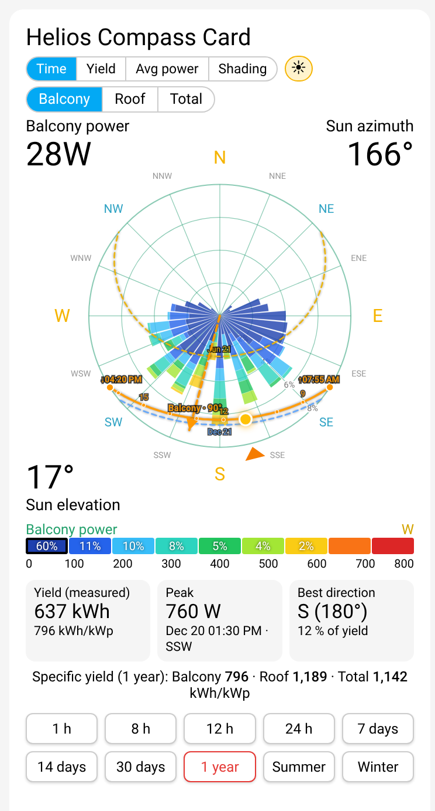
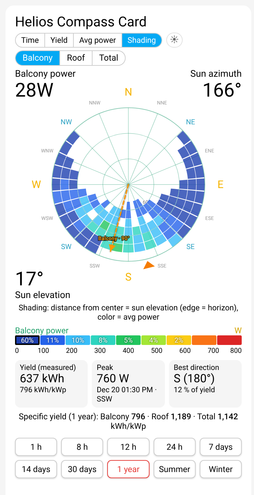
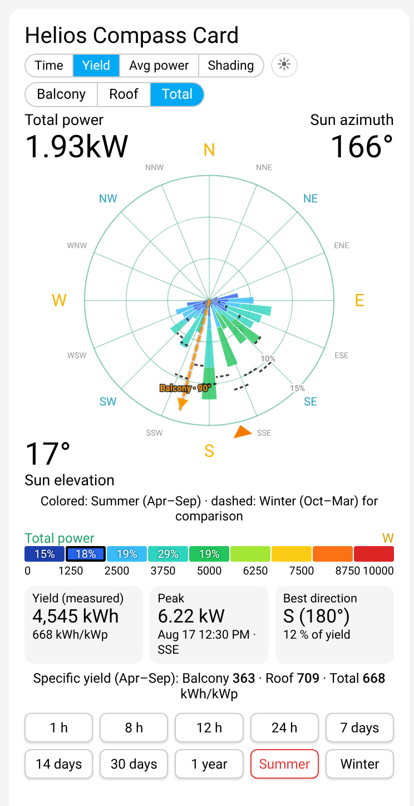

# ☀️ Helios Compass Card

🇬🇧 **English** · 🇩🇪 [Deutsch](README.de.md)

[](https://hacs.xyz/)
[](https://github.com/muhkuh666/helios-compass-card/actions/workflows/validate.yml)


**A solar compass for Home Assistant.** This card shows which compass direction your solar system gets its power from. Each sector of the rose is a sun direction. Colors show power classes, and the sector length shows the share of time or yield. An aerial image of your house can sit underneath.

Works for balcony solar systems, rooftop systems, or both at once.

<p align="center">
  
  
  
</p>
<p align="center"><sub>Left: “Time” view over 1 year with sun paths · Middle: shading map · Right: summer with winter dashed for comparison</sub></p>

[](https://my.home-assistant.io/redirect/hacs_repository/?owner=muhkuh666&repository=helios-compass-card&category=plugin)

---

## Features

- **Solar rose:** a 16-point compass rose (N, NNE, NE … NNW) with sectors by sun direction, stacked by power class.
- **Five views** you can switch between:
  - **Power:** power history as dots and line (angle = sun direction, distance = power in W/kW) with a dot for the current power.
  - **Time:** how long the sun came from each direction.
  - **Yield:** how many kWh came from each direction.
  - **Avg power:** average power per direction.
  - **Shading:** a shading map of direction × sun elevation. It shows at which sun positions trees or neighboring buildings cast shade.
- **Sun paths:** today's path with times, sunrise and sunset, plus the paths on the longest day (Jun 21) and the shortest day (Dec 21).
- **Periods:** **Today** (since midnight), 1, 8, 12 and 24 hours, 7, 14 and 30 days, 1 year, plus **Summer** and **Winter**, each compared with the other season.
- **Measured yield:** add an energy meter (kWh) per system, and yield, kWh/kWp and “Yield today” are measured instead of calculated.
- **Yield per kWp:** specific yield per system, e.g. “Balcony 1.8 · Roof 1.5 kWh/kWp”, for a fair comparison.
- **Several systems:** e.g. balcony, roof and “Total” (sum), switchable in one card.
- **Yield per direction in kWh:** the “Yield” view shows how many kWh came from each direction, e.g. today. With an energy meter, the total is measured.
- **Utilization in %:** per system and in total, as a row with bars and as a corner value.
- **Key figures:** yield for the period, peak power with time and direction, best direction.
- **Panel orientation:** dashed arrows with name and tilt for each array.
- **House image (optional):** rotate, move, scale and crop to a circle.
- **Live values:** sun marker as arrow, circle, sun symbol or dot, at the edge or at sun elevation, sun azimuth, sun elevation and current power in the corners.
- **Legend:** share per power class. The class of the current power is outlined.
- **English & German:** the language follows your Home Assistant user automatically (`language: auto | en | de`).
- **Visual editor:** every option can be set with clicks, YAML is optional.
- Tooltips when you hover over sectors. Clicking a corner value opens the entity details.
- The selected system, view and period are remembered per browser.

The card calculates the sun position for the history from your Home Assistant location. All you need is your power sensor.

---

## Installation

### Via HACS (recommended)

1. Click **“Open in HACS”** above. Alternatively: **HACS → ⋮ → Custom repositories**, enter the URL `https://github.com/muhkuh666/helios-compass-card` and choose the type **Dashboard**.
2. Search for **Helios Compass Card** and select **Download**.
3. Reload your browser with **Ctrl+F5**. In the Companion app, reset the frontend cache instead.

HACS adds the resource automatically.

### Manual

1. Copy `helios-compass-card.js` to `/config/www/`.
2. Go to **Settings → Dashboards → ⋮ → Resources → Add resource**. URL: `/local/helios-compass-card.js`, type: **JavaScript module**.
3. Reload your browser with **Ctrl+F5**.

---

## Quick start

Edit your dashboard, choose **Add card** and search for **“Helios Compass Card”**. Pick your PV power sensor and you are done.

Minimal YAML:

```yaml
type: custom:helios-compass-card
power_entity: sensor.pv_power
max_power: 8000
```

For a balcony system:

```yaml
type: custom:helios-compass-card
title: Balcony
power_entity: sensor.balcony_power
max_power: 800
legend_label: Balcony power
```

---

## Visual editor

The editor is split into sections. The preview updates with every change.

| Section | Contents |
|---|---|
| ⚙️ **General** | title, PV sensor, maximum power, color scale label, kWp, energy meter |
| 🧭 **Display** | default view, default period, visible views and period buttons, summer/winter comparison, sun paths, number and opacity of sectors, elevation rings of the shading view, show/hide switch, key figures and color scale |
| 🏠 **House image** | image path, rotation, offset, size, opacity, circular crop |
| 🔲 **Corner values** | per corner: power of the selected system, yield today, any entity (with unit and decimals), sun azimuth, sun elevation or hidden |
| 🔆 **Systems** | several sensors with kWp, energy meters, their own arrays and power classes, sum “Total”, default system |
| 📐 **Panel orientation** | arrays for all systems: name, color, azimuth, tilt, kWp |
| 🎨 **Power classes & colors** | automatic, or edit each step with a color picker |
| 🛠️ **Advanced** | sun entity, hourly value for long periods, refresh interval, location, conversion factor, language |

You can add, remove and reorder lists (systems, arrays, color steps) with ↑ ↓. The editor only writes values to YAML that differ from the defaults.

---

## The five views

| View | Display | Legend | What for? |
|---|---|---|---|
| **Power** | history as dots/line, distance from center = power (rings in W/kW), large dot = current power | share of time per power class | When did how much power come from which direction? |
| **Time** | share of sun time from this direction | share of time per power class | Where is the sun when, and how much do you get then? |
| **Yield** | kWh from this direction (or share in %, `energy_display`) | share of yield per power class | Where does your energy come from, e.g. today? |
| **Avg power** | average power with sun from this direction | share of time per power class | Which direction delivers the most on average? |
| **Shading** | grid of direction × sun elevation (edge = horizon, center = zenith), color = avg power | share of time per power class | At which sun positions is there shade? |

Only the time when the sun is above the horizon counts.

**Tip for the shading view:** choose **1 year** so that as many sun positions as possible are covered. An area that is darker than its neighbors at the same elevation points to shading. Typical cases are a low winter sun and trees in the southwest.

---

## Sun paths

The card draws on top of the rose:

- **Today** (orange): with hour markers, times every 3 hours, and sunrise ↑ and sunset ↓ with times.
- **Jun 21** (yellow, dashed): longest day, highest sun path.
- **Dec 21** (blue, dashed): shortest day, lowest sun path.
- **Sun now:** a glowing dot on today's path.

For the paths, the distance from the center is the sun elevation (edge = horizon, center = zenith). Together with the house image, you can see which roof area gets sun when, in each season. Hover over a path to see sunrise, sunset, direction and maximum elevation.

Use the **☀ button** at the top right to show or hide the paths on the card. Your choice is remembered.

```yaml
show_sun_paths: true
sun_path_toggle: true
sun_paths: [today, summer, winter]
```

You can remove the **Shading** view (or any other) from the switch with `metrics`, in the editor under 🧭 Display → *Visible views*:

```yaml
metrics: [time, energy, avg_power]
```

---

## Long periods & seasons

| Button | Period |
|---|---|
| 30 days | the last 30 days |
| 1 year | the last 365 days |
| Summer | April to September of the last 12 months |
| Winter | October to March of the last 12 months |

With **Summer** and **Winter**, the other season appears as a **dashed outline** for comparison (`season_overlay`). All periods from 7 days use the long-term statistics that Home Assistant keeps permanently. 1 year, Summer and Winter share the same data and load it only once.

---

## Measured yield (energy meter)

Without an energy meter, the card calculates the yield from the power history. That is accurate enough for the distribution by direction, but it can differ from your inverter's meter. If you set an **energy sensor** per system (`energy_entity`), the card uses the real measured values for:

- **Yield** in the key figures. It is then labeled “Yield (measured)”.
- **kWh/kWp** and the comparison of systems.
- the corner value **“Yield today”** (`type: energy_today`).

Suitable sensors are total meters (e.g. “PV total yield”) and meters that reset daily (e.g. “PV daily yield”) in Wh, kWh or MWh. They need long-term statistics, i.e. `state_class: total_increasing` or `total`. That applies to every sensor you can select in the Energy dashboard.

```yaml
sources:
  - name: Balcony
    entity: sensor.balcony_power
    energy_entity: sensor.balcony_energy_total
    kwp: 0.8
  - name: Roof
    entity: sensor.roof_power
    energy_entity: sensor.roof_energy_total
    kwp: 6.0
corners:
  bottom_right: {type: energy_today}
```

For “Total”, the measured yield is only used if every system has an energy meter. The distribution across directions still comes from the power history.

---

## Yield per kWp

If you enter the system size in kWp, the card shows the **specific yield** in kWh/kWp:

- Under **Yield**, it appears below the yield of the selected system.
- With several systems, a comparison appears below the key figures, e.g. *Specific yield (1 year): Balcony 980 · Roof 1,050 · Total 1,040 kWh/kWp*.

```yaml
sources:
  - {name: Balcony, entity: sensor.balcony_power, max_power: 800, kwp: 0.8}
  - {name: Roof, entity: sensor.roof_power, max_power: 8000, kwp: 6.0}
```

Without `kwp`, the card uses the sum of the `kwp` values of the system's arrays. For a single sensor, `kwp` goes at the top level. Note: 750 Wp = `0.75` kWp.

---

## Several systems

Instead of `power_entity`, set a list `sources`, in the editor under **🔆 Systems**. A switch then appears above the rose, e.g. **Balcony | Roof | Total**.

```yaml
type: custom:helios-compass-card
title: Helios Compass Card
sources:
  - name: Balcony
    entity: sensor.balcony_power
    max_power: 800
    modules:
      - {name: Balcony, azimuth: 195, tilt: 90}
  - name: Roof
    entity: sensor.roof_power
    max_power: 8000
    modules:
      - {name: Roof east, azimuth: 110, tilt: 35, color: '#e040fb'}
      - {name: Roof west, azimuth: 290, tilt: 35, color: '#00e5ff'}
show_total: true
total_name: Total
default_source: total
```

- Each system has its own power scale, color steps and panel arrows.
- **Total** adds up all systems. Its scale is the rounded sum of all `max_power` values.
- The top-left corner (`type: source`) always shows the power of the selected system, e.g. “Balcony power”, “Roof power” or “Total power”.

---

## Aligning the house image

Put an aerial image (drone, satellite, screenshot from a map app) at e.g. `/config/www/helios/house.png`. It is then available at `/local/helios/house.png`. The image is optional; without it, the center stays empty.

Align it in the editor under **🏠 House image**:

1. **Rotation:** rotate until north is up. In Google Maps north is always up, so you can see there how your house is oriented.
2. **Offset:** move the house to the exact center of the compass.
3. **Image size:** scale it to fit.
4. **Crop to circle:** so nothing sticks out of the compass.

```yaml
image: /local/helios/house.png
image_rotation: -32.5
image_offset_x: 4
image_offset_y: -6
image_scale: 1.1
image_clip: true
```

---

## Panel orientation

```yaml
modules:
  - name: Balcony
    azimuth: 195     # 90 = east, 180 = south, 270 = west
    tilt: 90         # tilt in degrees (optional)
    kwp: 0.8         # optional, shown in the tooltip
    color: '#ff9800' # optional
```

Global `modules` appear for every system. Arrays inside a system appear only for that system and for “Total”.

---

## Power classes & colors

By default there are 9 color steps from 0 to `max_power`. Custom steps:

```yaml
color_stops:
  - {value: 0, color: '#1e40af'}
  - {value: 200, color: '#22c55e'}
  - {value: 500, color: '#facc15'}
  - {value: 700, color: '#dc2626'}
```

Each step starts at `value` and reaches up to the next step. The last step applies from its value upwards.

---

## Corner values

```yaml
corners:
  top_left:     {type: source}                         # power of the selected system
  top_right:    {type: azimuth, name: Sun azimuth}
  bottom_left:  {type: elevation, name: Sun elevation}
  bottom_right: {type: energy_today}                   # yield today (needs energy_entity)
```

| Type | Shows |
|---|---|
| `type: source` | power of the selected system (sum for “Total”) |
| `type: utilization` | utilization of the selected system in % |
| `type: energy_today` | yield today of the selected system (needs `energy_entity`) |
| `entity: …` | any entity, optionally with `unit` and `decimals` |
| `type: azimuth` | current sun azimuth |
| `type: elevation` | current sun elevation |
| `null` | hide the corner |

`name` is always optional. For power values (`type: source` or entities in W/kW), set the unit per corner with `power_unit: W` or `power_unit: kW`.

Defaults: top left shows the power of the selected system, top right the sun azimuth, bottom left the sun elevation, bottom right is empty.

---

## All options

### General & display

| Option | Default | Description |
|---|---|---|
| `power_entity` | **required**¹ | power sensor in W or kW, converted automatically |
| `title` | `Helios Compass Card` | card title, `""` hides it |
| `max_power` | `8000` | upper limit of the power classes in W, e.g. `800` for a balcony system |
| `legend_label` | `PV power` | color scale label |
| `energy_entity` | – | energy meter in Wh/kWh (single sensor), for measured yield |
| `kwp` | sum of `modules` | system size in **kWp** for kWh/kWp (single sensor), e.g. 750 Wp = `0.75` |
| `power_unit` | `auto` | show power in `W`, `kW` or automatically (`auto`, kW from 1000 W) |
| `power_style` | `both` | “Power” view: `both` (line with dots), `line`, `dots`, `area` (from 7 days: avg and max per direction) or `bars` (peak power per direction) |
| `energy_display` | `absolute` | “Yield” view: `absolute` (kWh per direction) or `percent` (share in %) |
| `show_utilization` | `true` | utilization row with % per system and in total |
| `utilization_base` | `kwp` | utilization relative to `kwp` (without kWp: max. power) or `max_power` |
| `sun_marker` | `arrow` | sun marker: `arrow`, `circle`, `sun`, `dot` or `none` |
| `sun_marker_position` | `edge` | `edge` or `elevation` (at sun elevation) |
| `sun_marker_color` | `#f57c00` | sun marker color |
| `metric` | `time` | default view: `power`, `time`, `energy`, `avg_power` or `shading` |
| `show_metric_switch` | `true` | show the view switch |
| `metrics` | all five | views in the switch: `power`, `time`, `energy`, `avg_power`, `shading` |
| `show_stats` | `true` | show the key figures |
| `show_legend` | `true` | show the color scale |
| `ranges` | all | visible period buttons: `today`, `1h`, `8h`, `12h`, `24h`, `7d`, `14d`, `30d`, `1y`, `summer`, `winter` |
| `default_range` | `8h` | initial period |
| `season_overlay` | `true` | with Summer/Winter, show the other season dashed |
| `show_sun_paths` | `true` | draw sun paths (initial state) |
| `sun_path_toggle` | `true` | ☀ button on the card to show/hide sun paths (remembered) |
| `sun_paths` | `[today, summer, winter]` | which paths: today, Jun 21, Dec 21 |
| `elevation_bands` | `9` | shading view: number of elevation rings (9 = 10°) |
| `sectors` | `36` | number of direction sectors (36 = 10° wide, 16 = compass points) |
| `sector_opacity` | `0.8` | sector opacity |
| `color_stops` | 9 steps up to `max_power` | list of `{value, color}` |
| `modules` | – | arrays for all systems |
| `corners` | see above | values in the four corners |

¹ Not needed when you use `sources`.

### House image

| Option | Default | Description |
|---|---|---|
| `image` | – | path to the house image (optional) |
| `image_scale` | `0.8` | image size relative to the compass |
| `image_rotation` | `0` | rotation in degrees, positive = clockwise |
| `image_offset_x` | `0` | offset in % of the compass radius, + = right (east) |
| `image_offset_y` | `0` | offset in % of the compass radius, + = up (north) |
| `image_opacity` | `1` | image opacity |
| `image_clip` | `false` | crop the image to the compass circle |

### Several systems

| Option | Default | Description |
|---|---|---|
| `sources` | – | list of systems, see below |
| `show_total` | `true` | show “Total” as a sum (with several systems) |
| `total_name` | `Total` | label of the sum |
| `total_max_power` | automatic | scale for “Total” |
| `total_color_stops` | automatic | color steps for “Total” |
| `default_source` | first system | initial system: entity or `total` |

**Per system in `sources`:**

| Option | Description |
|---|---|
| `entity` | **required**, power sensor (W or kW) |
| `name` | name in the switch and the legend |
| `max_power` | upper limit of this system's power classes |
| `kwp` | system size in kWp (for kWh/kWp) |
| `energy_entity` | energy meter of this system (Wh/kWh) |
| `color_stops` | own color steps |
| `modules` | own arrays |
| `legend_label` | own color scale label |

### Advanced

| Option | Default | Description |
|---|---|---|
| `sun_entity` | `sun.sun` | source of the current sun position |
| `stats_type` | `mean` | from 7 days: hourly mean (`mean`) or peak (`max`) |
| `refresh_interval` | `300` | reload the history every x seconds |
| `latitude` / `longitude` | HA location | override the location |
| `language` | `auto` | card language: `auto` (like Home Assistant), `en` or `de` |
| `unit_factor` | automatic | conversion factor to W, only for unusual units |

---

## Update notifications

If you installed the card via HACS, new versions appear automatically under **Settings → Updates** and in HACS.

Optionally, you can get a push notification on your phone. You can find the exact name of the update entity under Settings → Entities by searching for “helios”.

```yaml
alias: Helios Compass Card – update available
triggers:
  - trigger: state
    entity_id: update.helios_compass_card_update
    to: "on"
actions:
  - action: notify.mobile_app_YOUR_PHONE
    data:
      title: "☀️ Helios Compass Card"
      message: >
        Version {{ state_attr('update.helios_compass_card_update', 'latest_version') }} is available.
      data:
        url: /config/updates
        clickAction: /config/updates
mode: single
```

---

## Notes & troubleshooting

- **House image not shown** (e.g. in the Companion app):
  - Use a **relative path** like `/local/helios/house.png`, not an address like `http://192.168.…` or `http://homeassistant.local…`. The app cannot reach local addresses when you are away.
  - The file must be in `/config/www/`. If you just created the `www` folder, restart Home Assistant once.
  - Mind upper and lower case: `House.PNG` is not the same as `house.png`.
  - Shrink very large photos (over 2–3 MB) so they load quickly on phones.
  - In the app, go to **Settings → Companion app → Troubleshooting → Reset frontend cache** once.
  - If the card cannot load the image, it shows a note with the path at the bottom.
- **“Custom element doesn't exist: helios-compass-card”:** the JS file was not loaded.
  - Check that `/hacsfiles/helios-compass-card/helios-compass-card.js` shows code in your browser.
  - Check that the resource is listed under Settings → Dashboards → Resources.
  - Then reload with Ctrl+F5.
- **Periods from 7 days** use the long-term statistics. The sensor needs `state_class: measurement` for that. Without them, the card falls back to the regular history, as far back as the recorder keeps it.
- **1 to 24 hours** come from the recorder history at 1- or 5-minute resolution.
- Without `energy_entity`, the card calculates the **yield** from the power history, so it can differ slightly from your inverter's meter. With an energy meter it is measured.
- From 7 days, the **peak for “Total”** is an upper estimate, because hourly maximums are added up.
- Numbers, dates and times follow the selected language. The card supports light and dark mode via the Home Assistant theme colors.

---

## Changelog

| Version | Changes |
|---|---|
| **1.11.1** | Maintenance release for inclusion in the HACS store (all checks passed) |
| **1.11.0** | “Power” view as line with dots, line only, dots only, area or bars (`power_style`) |
| **1.10.0** | New “Power” view: power history as dots/line by sun direction with a dot for the current power, rings in W/kW |
| **1.9.0** | “Today” period; “Yield” view in kWh per direction (`energy_display`); power unit W/kW selectable (card and per corner); utilization in % per system and in total (row and corner value); sun marker as arrow, circle, sun symbol or dot, at the edge or at sun elevation |
| **1.8.0** | English translation (card, editor, README); language follows the HA user automatically, option `language`; English compass points (E instead of O) |
| **1.7.1** | House image as an HTML layer instead of SVG, so it works reliably in the Companion app (iOS/Android); note when the image cannot be loaded |
| **1.7.0** | Energy meter per system (`energy_entity`): measured yield and kWh/kWp; new corner value “Yield today” (`type: energy_today`) |
| **1.6.1** | ☀ button to show/hide sun paths; selectable views in the switch (e.g. without “Shading”); editor hides the single sensor when systems are set; shorter field labels |
| **1.6.0** | Sun paths (today with sunrise/sunset, Jun 21, Dec 21); “Shading” view (direction × sun elevation); periods 30 days, 1 year, Summer, Winter with comparison; kWp per system and specific yield kWh/kWp |
| **1.5.1** | With several systems, the top-left corner follows the selection automatically, also for older configurations |
| **1.5.0** | Visual editor for all options: lists for systems, arrays and color steps with a color picker; corners with unit and decimals |
| **1.4.0** | Move and crop the house image, finer rotation; 12 h period; name “Helios Compass Card” |
| **1.3.0** | Several systems with a switch and sum “Total”; kW display from 1000 W |
| **1.2.1** | Ring labels adapt when there is no house image |
| **1.2.0** | Views Time / Yield / Avg power, key figures, panel orientation, first visual editor |
| **1.1.0** | Solar rose with sectors instead of dots |
| **1.0.0** | First version |

---

## License

[MIT](LICENSE) © muhkuh666
